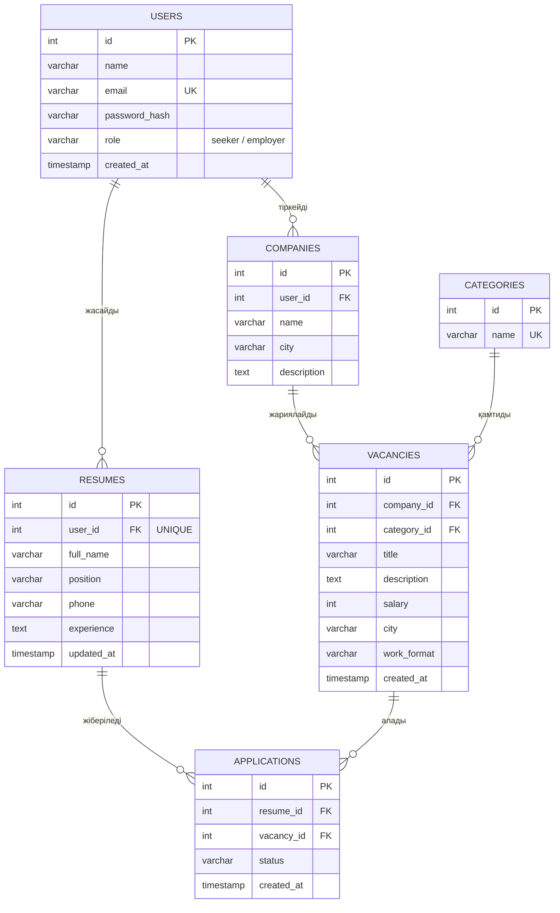

# 💼 JumysHub — Жұмыс орындары мен резюме платформасы

## Жоба туралы

**JumysHub** — жұмыс іздеушілер мен жұмыс берушілерді байланыстыратын веб-қосымша. Пайдаланушы вакансияларды іздей алады, резюме жасайды және ұнаған жұмысқа өтініш береді.

### Жобаның мақсаты

Жұмыс іздеушілерге лайықты вакансияны оңай табуға, ал жұмыс берушілерге қажетті маманды жылдам табуға мүмкіндік беретін ыңғайлы платформа жасау.

### Негізгі мүмкіндіктер

- 🔐 Тіркелу және жүйеге кіру (жұмыс іздеуші немесе жұмыс беруші)
- 🔎 Вакансияларды лауазым, компания, сала және қала бойынша іздеу
- 📄 Онлайн резюме жасау және сақтау
- 📨 Вакансияға өтініш беру
- ❤️ Ұнаған вакансияларды сақтау
- 🏢 Жұмыс беруші кабинеті (вакансия қосу, өзгерту, өтініштерді қарау)
- 👤 Жеке кабинет (резюме, өтініштер, сақталған вакансиялар)
- 📱 Адаптивті дизайн (компьютер, планшет, телефон)

### Қолданылатын технологиялар

| Бөлім | Технология |
|---|---|
| Frontend | HTML5, CSS3, JavaScript |
| Backend | PHP |
| Дерекқор | MySQL (XAMPP) |
| Нұсқаларды басқару | Git, GitHub |

---

## Беттер тізімі

| № | Бет | Сипаттамасы | Негізгі функциялар |
|---|---|---|---|
| 1 | **Басты бет** (`index.php`) | Сайтқа кіріспе бет | Іздеу жолағы, салалар, жаңа вакансиялар |
| 2 | **Тіркелу** (`register.php`) | Жаңа пайдаланушыны тіркеу | Аты, email, рөлі, құпиясөз, деректерді тексеру |
| 3 | **Кіру** (`login.php`) | Жүйеге кіру | Email және құпиясөз арқылы кіру |
| 4 | **Вакансиялар** (`catalog.php`) | Барлық вакансиялар тізімі | Серверде іздеу, сүзгі (сала, қала, формат, күн, жалақы), сұрыптау, пагинация |
| 5 | **Резюме** (`resume.php`) | Резюме жасау, өңдеу, жою | Аты-жөні, лауазым, телефон, тәжірибе (дерекқорда сақталады) |
| 6 | **Вакансия беті** (`job.php`) | Бір вакансия туралы толық ақпарат | Сипаттама, талаптар, жалақы; иесіне — өңдеу және жою |
| 7 | **Жеке кабинет** (`profile.php`) | Пайдаланушы профилі (жабық бет) | Аккаунт деректері, резюме немесе компаниялар |
| 8 | **Жұмыс беруші кабинеті** (`employer.php`) | Вакансияларды басқару (жабық бет) | Вакансиялар кестесі, қосу / өңдеу / жою |
| 9 | **Вакансия формасы** (`vacancy_form.php`) | Вакансия қосу және өңдеу | Create / Update, серверде тексеру |
| 10 | **Шығу** (`logout.php`) | Жүйеден шығу | Сессияны жою (POST + CSRF) |

> 1–5 беттер 9-аптада HTML түрінде жасалып (`frontend/` папкасы), 10-аптада PHP-ға көшірілді. 11-аптада дерекқор мен аутентификация, 12-аптада вакансиялардың CRUD-ы қосылды.

---

## Дерекқор құрылымы (ER-диаграмма)



### Кестелер арасындағы байланыстар

- **USERS → COMPANIES** (бір-көп): жұмыс беруші бірнеше компанияны тіркей алады.
- **USERS → RESUMES** (бір-бір): әр жұмыс іздеушінің бір резюмесі болады.
- **COMPANIES → VACANCIES** (бір-көп): бір компания бірнеше вакансия жариялайды.
- **CATEGORIES → VACANCIES** (бір-көп): бір салада бірнеше вакансия болады.
- **RESUMES ↔ VACANCIES** (көп-көп) `APPLICATIONS` кестесі арқылы: бір резюме көп вакансияға жіберіледі, бір вакансияға көп өтініш түседі.

---

## Жоба құрылымы

```
jumyshub/
├── README.md
├── config.php           — дерекқор баптаулары
├── index.php            — басты бет (соңғы вакансиялар, салалар)
├── catalog.php          — вакансиялар: іздеу, сүзгі, сұрыптау, пагинация (SQL + prepared statements)
├── job.php              — бір вакансия (Read)
├── register.php         — тіркелу (password_hash)
├── login.php            — кіру (password_verify, сессия)
├── logout.php           — шығу
├── profile.php          — жеке кабинет (жабық бет)
├── resume.php           — резюме: жасау / өңдеу / жою
├── employer.php         — жұмыс беруші: вакансиялар кестесі
├── vacancy_form.php     — вакансия қосу (Create) және өңдеу (Update)
├── vacancy_delete.php   — вакансияны жою (Delete)
├── database/
│   └── jumyshub.sql     — кестелер және мысал деректер
├── includes/
│   ├── init.php         — әр бетке ортақ қосылатын файл
│   ├── db.php           — PDO арқылы MySQL-ге қосылу
│   ├── auth.php         — сессия, кіру/шығу, жабық беттер, CSRF
│   ├── functions.php    — тексеру және көмекші функциялар
│   ├── header.php       — беттің жоғарғы бөлігі
│   ├── footer.php       — беттің төменгі бөлігі
│   └── job_card.php     — вакансия карточкасы
├── assets/
│   ├── css/style.css
│   └── js/main.js
└── frontend/            — 9-аптаның статикалық HTML нұсқасы
```

## 10-апта: PHP және серверлік өңдеу

- Беттер `.php` файлдарына көшірілді, ортақ `header` пен `footer` бөліктері `include` арқылы қосылады.
- Кіру, тіркелу және резюме формалары `$_POST` арқылы өңделеді, деректер серверде тексеріледі.
- Вакансияларды іздеу, сүзу және сұрыптау `$_GET` арқылы серверде орындалады.
- Шығарылатын мәтін `htmlspecialchars` арқылы қорғалған (`e()` функциясы).

## 11-апта: Дерекқор және аутентификация

- `database/jumyshub.sql` — MySQL дерекқоры: `users`, `companies`, `categories`, `vacancies`, `resumes`, `applications` кестелері, сыртқы кілттер (FOREIGN KEY) және мысал деректер.
- `includes/db.php` — **PDO** арқылы қосылу (`ERRMODE_EXCEPTION`, `utf8mb4`, нағыз prepared statements).
- **Тіркелу:** email бос екені дерекқордан тексеріледі, құпиясөз `password_hash()` арқылы хэш түрінде сақталады. Жұмыс берушіге компания бірге құрылады (транзакция).
- **Кіру:** `password_verify()` арқылы тексеріледі, `session_regenerate_id()` сессияны жаңартады, пайдаланушы id-і `$_SESSION`-да сақталады.
- **Шығу:** `logout.php` сессияны толық жояды (тек POST сұранысымен).
- **Жабық беттер:** `require_login()` және `require_role()` — кірмеген пайдаланушы кіру бетіне, басқа рөлдегі пайдаланушы кабинетке бағытталады.
- Барлық POST формаларында **CSRF токені** бар.

## 12-апта: CRUD операциялары

Негізгі объект — **вакансия** (`vacancies` кестесі). Оны жұмыс беруші басқарады:

| Операция | Файл | SQL |
|---|---|---|
| **Create** — қосу | `vacancy_form.php` | `INSERT INTO vacancies ... VALUES (?, ?, ...)` |
| **Read** — көрсету | `employer.php`, `catalog.php`, `job.php` | `SELECT ... WHERE c.user_id = ?` |
| **Update** — өңдеу | `vacancy_form.php?id=…` | `UPDATE vacancies SET ... WHERE id = ?` |
| **Delete** — жою | `vacancy_delete.php` | `DELETE FROM vacancies WHERE id = ?` |

- Барлық сұраныстар **prepared statements** (`prepare()` + `execute()`) арқылы орындалады — пайдаланушы енгізген мән SQL мәтініне тікелей қосылмайды, сондықтан **SQL инъекциясынан** қорғалған.
- Сұрыптау бағыты рұқсат етілген тізімнен ғана таңдалады.
- Жұмыс беруші тек **өз** вакансияларын өңдеп, жоя алады (иесі серверде тексеріледі).
- Жою алдында растау сұралады, жою тек POST + CSRF арқылы орындалады.
- Форма деректері серверде тексеріледі (атау, компания, сала, қала, формат, жалақы 50 000–10 000 000 ₸, сипаттама).
- Қосымша: жұмыс іздеушінің **резюмесі** де CRUD арқылы жасалады, өңделеді және жойылады.

## 13-апта: Мәліметтермен жұмыс

`catalog.php` бетіндегі барлық өңдеу **серверде, SQL сұранысы арқылы** орындалады (JavaScript-те емес). Параметрлер `$_GET` арқылы беріледі, сондықтан нәтиже сілтемемен бөлісуге болады.

| Мүмкіндік | `$_GET` параметрі | SQL |
|---|---|---|
| **Іздеу** — лауазым, компания, сипаттама | `q` | `v.title LIKE ? OR c.name LIKE ? OR v.description LIKE ?` |
| **Сүзгі: сала** | `category` | `cat.name = ?` |
| **Сүзгі: қала** | `city` | `v.city = ?` |
| **Сүзгі: жұмыс форматы** | `format` | `v.work_format = ?` |
| **Сүзгі: жарияланған күні** (24 сағат / 7 / 30 күн) | `period` | `v.created_at >= NOW() - INTERVAL ? DAY` |
| **Сүзгі: ең төменгі жалақы** | `salary_min` | `v.salary >= ?` |
| **Сұрыптау** — жаңа / ескі, жалақы ↓ / ↑, атауы А-Я | `sort` | `ORDER BY ...` (тек рұқсат етілген тізімнен) |
| **Пагинация** — бетте 6 вакансия | `page` | `SELECT COUNT(*)` + `LIMIT ? OFFSET ?` |

- Барлық мәндер **prepared statements** арқылы беріледі; `LIKE` ішіндегі `%` және `_` таңбалары экрандалады.
- Сұрыптау мен күн сүзгісінің мәні рұқсат етілген тізіммен (whitelist) тексеріледі, қате мән болса әдепкі мән алынады.
- Бет нөмірі бүтін сан ретінде тексеріледі; беттер санынан асса, соңғы бет көрсетіледі.
- Пагинация сілтемелері таңдалған сүзгілерді сақтайды (`http_build_query`), «Тазалау» батырмасы сүзгілерді алып тастайды.
- Беттің жоғарғы жағында жалпы саны мен көрсетіліп тұрған аралық шығады: «Табылды: 20 вакансия · 7–12 көрсетілген, 2 / 4 бет».
- Пагинацияны көрсету үшін `database/jumyshub.sql` файлына әр түрлі күнде жарияланған 8 вакансия қосылды (барлығы 20).

## Жобаны іске қосу

1. Репозиторийді жүктеп, `C:\xampp\htdocs\jumyshub\` папкасына салыңыз.
2. XAMPP Control Panel-де **Apache** және **MySQL** іске қосыңыз.
3. `http://localhost/phpmyadmin` → **Import** → `database/jumyshub.sql` файлын таңдап, **Go** басыңыз.
4. Браузерде `http://localhost/jumyshub/` ашыңыз.

> MySQL басқа портта жұмыс істесе (мысалы, 3307), жоба папкасында `config.local.php` файлын жасаңыз:
> `<?php return ['db_port' => 3307];`

**Демо аккаунттар** (құпиясөзі: `demo123`):

| Рөлі | Email |
|---|---|
| Жұмыс беруші | `employer@jumyshub.kz` |
| Жұмыс іздеуші | `seeker@jumyshub.kz` |

## Жұмыс жоспары

- [x] **8-апта:** Жоспарлау, репозиторий құру, README, беттер тізімі, ER-диаграмма
- [x] **9-апта:** Frontend — негізгі беттердің макеті және статикалық беттер
- [x] **10-апта:** PHP беттері, `include`, `$_POST` және `$_GET` формалары, қалта құрылымы
- [x] **11-апта:** MySQL дерекқоры, PDO, тіркелу (`password_hash`), кіру, сессия, шығу, жабық беттер
- [x] **12-апта:** Вакансиялардың толық CRUD-ы, prepared statements, SQL инъекциясынан қорғау
- [x] **13-апта:** Серверде іздеу, сүзгі (сала, қала, формат, күн, жалақы), сұрыптау және пагинация
- [ ] Келесі апталар: вакансияға өтініш беру, тестілеу

> Сайттағы вакансиялар мен компаниялар — мысал деректер.

## Авторы

**Аты-жөні:** Кеңесова Жанел  
**Тобы:** 336
