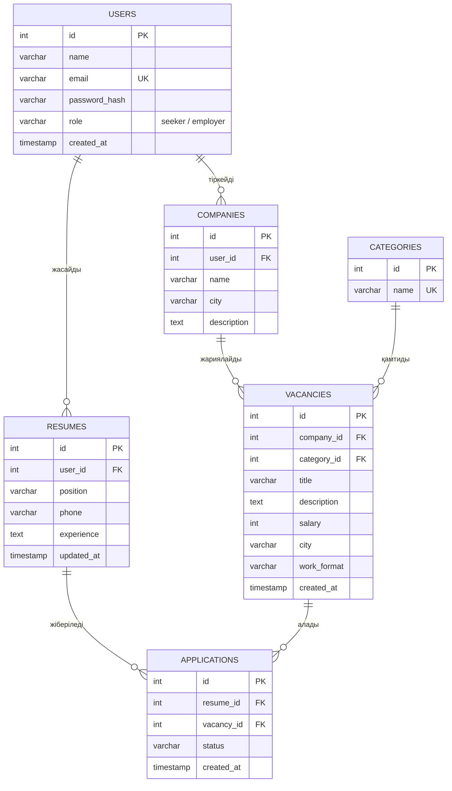

# 💼 JumysHub — Жұмыс орындары мен резюме платформасы

## Жоба туралы

**JumysHub** — жұмыс іздеушілер мен жұмыс берушілерді байланыстыратын веб-қосымша. Пайдаланушы вакансияларды іздей алады, резюме жасайды және ұнаған жұмысқа өтініш береді.

### Жобаның мақсаты

Жұмыс іздеушілерге лайықты вакансияны оңай табуға, ал жұмыс берушілерге қажетті маманды жылдам табуға мүмкіндік беретін ыңғайлы платформа жасау.

### Негізгі мүмкіндіктер

- 🔐 Тіркелу және жүйеге кіру (жұмыс іздеуші немесе жұмыс беруші)
- 🔎 Вакансияларды лауазым, компания, сала және қала бойынша іздеу
- 📄 Онлайн резюме жасау және сақтау
- 📨 Вакансияға өтініш беру
- ❤️ Ұнаған вакансияларды сақтау
- 🏢 Жұмыс беруші кабинеті (вакансия қосу, өзгерту, өтініштерді қарау)
- 👤 Жеке кабинет (резюме, өтініштер, сақталған вакансиялар)
- 📱 Адаптивті дизайн (компьютер, планшет, телефон)

### Қолданылатын технологиялар

| Бөлім | Технология |
|---|---|
| Frontend | HTML5, CSS3, JavaScript |
| Backend | PHP |
| Дерекқор | MySQL (XAMPP) |
| Нұсқаларды басқару | Git, GitHub |

---

## Беттер тізімі

| № | Бет | Сипаттамасы | Негізгі функциялар |
|---|---|---|---|
| 1 | **Басты бет** (`index.php`) | Сайтқа кіріспе бет | Іздеу жолағы, салалар, жаңа вакансиялар |
| 2 | **Тіркелу** (`register.php`) | Жаңа пайдаланушыны тіркеу | Аты, email, рөлі, құпиясөз, деректерді тексеру |
| 3 | **Кіру** (`login.php`) | Жүйеге кіру | Email және құпиясөз арқылы кіру |
| 4 | **Вакансиялар** (`catalog.php`) | Барлық вакансиялар тізімі | Іздеу, сала мен қала бойынша сүзгілеу, сұрыптау, сақтау |
| 5 | **Резюме жасау** (`resume.php`) | Резюме толтыру формасы | Аты-жөні, лауазым, телефон, тәжірибе, деректерді тексеру |
| 6 | **Вакансия беті** (`job.php`) | Бір вакансия туралы толық ақпарат | Сипаттама, талаптар, жалақы, өтініш беру |
| 7 | **Жеке кабинет** (`profile.php`) | Пайдаланушы профилі | Резюме, өтініштер, сақталған вакансиялар |
| 8 | **Жұмыс беруші кабинеті** (`employer.php`) | Вакансияларды басқару | Вакансия қосу/өзгерту/жою, өтініштерді қарау |

> 1–5 беттер 9-аптада HTML түрінде жасалып (`frontend/` папкасы), 10-аптада PHP-ға көшірілді. 6–8 беттер келесі апталарға жоспарланған.

---

## Дерекқор құрылымы (ER-диаграмма)



### Кестелер арасындағы байланыстар

- **USERS → COMPANIES** (бір-көп): жұмыс беруші бірнеше компанияны тіркей алады.
- **USERS → RESUMES** (бір-көп): жұмыс іздеуші бірнеше резюме жасай алады.
- **COMPANIES → VACANCIES** (бір-көп): бір компания бірнеше вакансия жариялайды.
- **CATEGORIES → VACANCIES** (бір-көп): бір салада бірнеше вакансия болады.
- **RESUMES ↔ VACANCIES** (көп-көп) `APPLICATIONS` кестесі арқылы: бір резюме көп вакансияға жіберіледі, бір вакансияға көп өтініш түседі.

---

## Жоба құрылымы

```
jumyshub/
├── README.md
├── index.php          — басты бет
├── catalog.php        — вакансиялар, $_GET сүзгілері
├── login.php          — кіру, $_POST формасы
├── register.php       — тіркелу, $_POST формасы
├── resume.php         — резюме, $_POST формасы
├── includes/
│   ├── header.php     — беттің жоғарғы бөлігі
│   ├── footer.php     — беттің төменгі бөлігі
│   ├── job_card.php   — вакансия карточкасы
│   └── functions.php  — тексеру және көмекші функциялар
├── data/
│   └── jobs.php       — вакансиялар массиві
├── assets/
│   ├── css/style.css
│   └── js/main.js
└── frontend/          — 9-аптаның статикалық HTML нұсқасы
```

## 10-апта: PHP және серверлік өңдеу

- Беттер `.php` файлдарына көшірілді, ортақ `header` пен `footer` бөліктері `include` арқылы қосылады.
- Кіру, тіркелу және резюме формалары `$_POST` арқылы өңделеді, деректер серверде тексеріледі.
- Вакансияларды іздеу, сүзу және сұрыптау `$_GET` арқылы серверде орындалады.
- Шығарылатын мәтін `htmlspecialchars` арқылы қорғалған.
- Дерекқор әлі қосылмаған: вакансиялар PHP массивінде тұрады, форма деректері сақталмайды.

## Жобаны іске қосу

1. Репозиторийді жүктеп, `C:\xampp\htdocs\` папкасына салыңыз.
2. XAMPP-та **Apache** іске қосыңыз.
3. Браузерде `http://localhost/<папка_аты>/` ашыңыз.

## Жұмыс жоспары

- [x] **8-апта:** Жоспарлау, репозиторий құру, README, беттер тізімі, ER-диаграмма
- [x] **9-апта:** Frontend — негізгі беттердің макеті және статикалық беттер
- [x] **10-апта:** PHP беттері, `include`, `$_POST` және `$_GET` формалары, қалта құрылымы
- [ ] Келесі апталар: Дерекқорды қосу, тестілеу

> Сайттағы вакансиялар мен компаниялар — мысал деректер.

## Авторы

**Аты-жөні:** Кеңесова Жанел  
**Тобы:** 336
